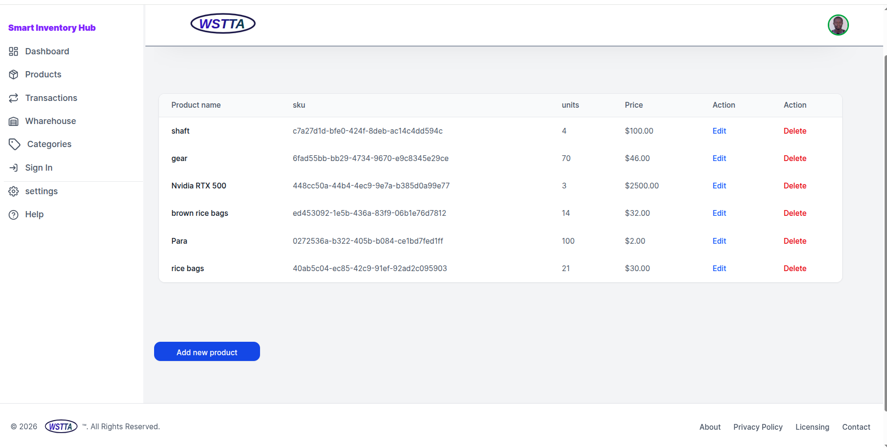

# SmartInventoryHub

SmartInventoryHub is a simple full-stack inventory management application for organizing goods and products in a professional environment. It provides basic CRUD operations to create, view, update, and remove inventory items.

## Features

- Add new products and goods
- View inventory items
- Update item details
- Remove items from inventory

## Tech Stack

- Frontend: Blazor && Tailwindcss
- Backend: ASP.NET Core
- Database: SQL Server

## Getting Started

1. Clone the repository:

    if ssh 

   ```bash
   git clone git@github.com:kafando2000/SmartInventoryHub.git
   cd SmartInventoryHub
   ```
   if http
    
    ```bash
    git clone https://github.com/kafando2000/SmartInventoryHub.git
    cd SmartInventoryHub
    ```

2. Install the frontend and backend dependencies:

   ```bash
   dotnet restore
   dotnet workload restore
   npm install
   ```

3. Configure SQL Server and the application environment variables.

    It is better to use a Docker container.

4. Start the server and client:

   ```bash
   ./launch_server_and_client.sh
   ```

## Usage
Use the web interface to manage your inventory by adding, editing, viewing, and deleting products.


